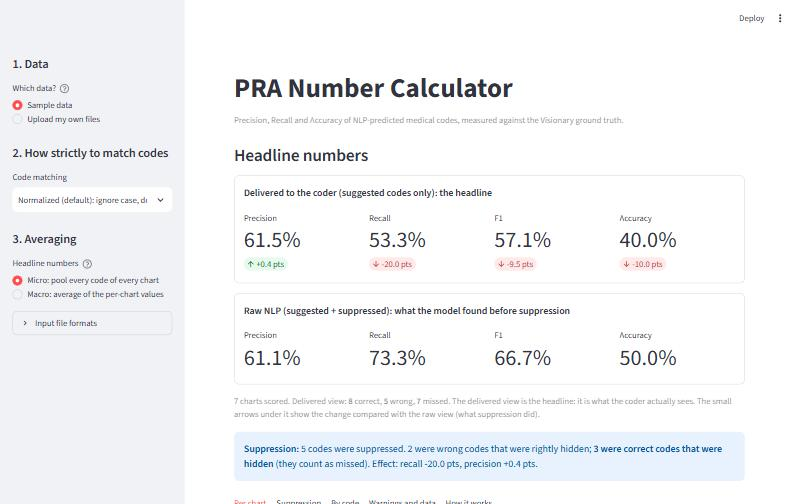

# PRA Number Calculator

A small Python UI that measures how good an **NLP medical-coding API** is, by comparing the codes it predicts for each chart with the **Visionary ground truth** (the master of truth), and reports **Precision**, **Recall**, **F1** and **Accuracy** ("PRA numbers").

The NLP returns two lists per chart: **suggested** codes (shown to the coder) and **suppressed** codes (found but held back). The tool treats them separately, so you can see not only how accurate the suggestions are but also **what the suppression step costs or gains**.



## What you get

* **Headline numbers**: precision, recall, F1 and accuracy for what the coder actually sees (suggested codes), next to the raw NLP numbers (suggested + suppressed), with the difference shown.
* **Per chart**: the numbers for each chart, a bar chart, and an inspector that labels every code *true positive*, *false positive*, *wrongly suppressed*, *missed*, or *rightly suppressed*.
* **Suppression analysis**: how many suppressed codes were right to hide and how many were good codes thrown away.
* **By code**: which codes the NLP gets wrong most often.
* **Choices you control**: how strictly codes must match (exact / normalized / ICD-10 category) and micro vs macro averaging.
* Works with your own CSV or JSON files, or the built-in sample.

## Quick start

You need **Python 3.10 or newer**. (Developed and tested on Python 3.14, Streamlit 1.66.)

### Windows

```bat
run.bat
```

The first run creates a private virtual environment (`.venv`), installs Streamlit, and opens the app in your browser at <http://localhost:8501>. Later runs start in seconds.

### macOS / Linux

```bash
./run.sh
```

### Or step by step (any OS)

```bash
python -m venv .venv
# Windows:        .venv\Scripts\activate
# macOS / Linux:  source .venv/bin/activate
pip install -r requirements.txt
streamlit run app.py
```

> **Windows tip:** if `python` opens the Microsoft Store, use the `py` launcher instead (`py -3 -m venv .venv`) or switch off *Settings > Apps > Advanced app settings > App execution aliases* for "python.exe". `run.bat` already prefers `py`.

## Try the example

1. Start the app. **Sample data** is selected by default: 7 charts that were chosen to show every situation (see the table in [docs/HOW_IT_WORKS.md](docs/HOW_IT_WORKS.md#8-the-worked-example)).
2. Look at the headline: **61.5% precision, 53.3% recall**.
3. Read the blue box: suppression hid 3 correct codes and cost **20 points of recall**.
4. Open **Per chart**, choose `CH-1003` in the inspector: one code was *wrongly suppressed* (`G47.33`), one was *missed* (`E66.9`), one *false positive* (`F41.9`).
5. Change **Code matching** to `exact` and then to `icd10_category` and watch the precision move: part of the "error" is only spelling or a parent code.

## Using your own data

Choose **Upload my own files** in the sidebar and upload two files.

**Ground truth** (CSV `chart_id,code`, one row per code):

```csv
chart_id,code
CH-1001,E11.9
CH-1001,I10
CH-1006,
```

A blank code row means the chart exists and has no codes.

**NLP output** (CSV `chart_id,code,status`, where status is `suggested` or `suppressed`):

```csv
chart_id,code,status
CH-1001,E11.9,suggested
CH-1001,E78.5,suppressed
```

JSON is accepted too (`data/ground_truth.json` and `data/nlp_output.json` are the same sample in JSON). Column names are forgiving (`ChartId`, `ICD-10`, `Type` ...). Problems in a file are reported in plain language in the UI.

## Without the UI

The calculation is a plain library and also has a command line:

```bash
python -m pra data/ground_truth.csv data/nlp_output.csv
python -m pra data/ground_truth.csv data/nlp_output.csv --mode icd10_category
```

```python
from pra import evaluate, parse_ground_truth, parse_nlp, read_text

truth = parse_ground_truth(read_text("data/ground_truth.csv"))
nlp = parse_nlp(read_text("data/nlp_output.csv"))
result = evaluate(truth, nlp, mode="normalized")
print(result.delivered.counts.precision, result.delivered.counts.recall)
```

## Project layout

```
pra-numbers/
  app.py                 the Streamlit UI (display only, no calculation)
  pra/                   the calculation library (standard library only)
    normalize.py         how strictly codes are matched
    loaders.py           CSV / JSON input, friendly errors
    models.py            the formulas (Counts) and result types
    metrics.py           evaluate(): compare, classify, aggregate
    report.py, __main__.py   text report and command line
  data/                  sample ground truth and NLP output (CSV and JSON)
  tests/                 unit tests of the hand-worked example, loaders and the UI
  docs/HOW_IT_WORKS.md   the strategy, representation, formulas and worked example
  run.bat, run.sh        one-command setup and start
  requirements.txt       streamlit
```

## Running the tests

```bash
pip install -r requirements-dev.txt
python -m pytest -q
```

The tests compare against numbers **worked out by hand** (documented in HOW_IT_WORKS.md), not against the program's own output, and include headless tests of the UI itself.

## How it works, in short

For every chart both sides become **sets of codes**:

| | in the ground truth | not in the ground truth |
|---|---|---|
| **suggested** by the NLP | true positive | false positive |
| **suppressed** by the NLP | false negative (a good code was hidden) | correctly hidden |
| **not output** | false negative (missed) | nothing |

`Precision = TP / (TP + FP)`, `Recall = TP / (TP + FN)`, `F1 = 2TP / (2TP + FP + FN)`, `Accuracy = TP / (TP + FP + FN)`.
A metric with nothing to measure is shown as **n/a**, never as 0% or 100%.

The full explanation, with the worked example and the decisions to confirm with your team, is in **[docs/HOW_IT_WORKS.md](docs/HOW_IT_WORKS.md)**.

## Troubleshooting

| Problem | Fix |
|---|---|
| `python` opens the Microsoft Store | Use `py -3` (see the Windows tip above) |
| `run.bat` says it cannot create the environment | Install Python 3.10+ from python.org and tick *Add to PATH* / install the *py launcher* |
| The browser does not open | Go to <http://localhost:8501> yourself |
| Port 8501 is busy | `streamlit run app.py --server.port 8502` |
| "missing column(s)" after an upload | The CSV needs `chart_id` and `code` (and `status` for the NLP file); see *Using your own data* |
| First start is slow | Streamlit and pandas are large to import the first time; later starts are fast |
