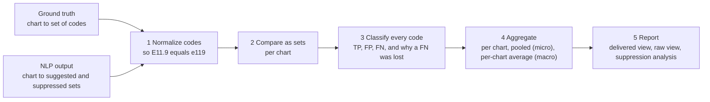
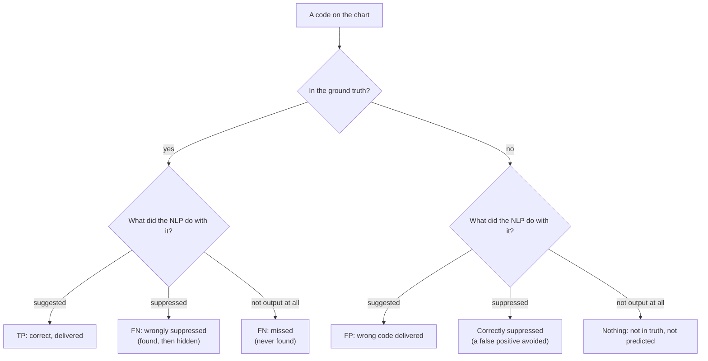

# How the PRA calculation works

This document explains the strategy, the way the data is represented, the formulas, and walks through one small example by hand. Every number in it comes from the sample data in `data/` and is checked by the automated tests, so you can reproduce it with `python -m pra data/ground_truth.csv data/nlp_output.csv` or in the UI.

> **"PRA number"** is read here as **P**recision, **R**ecall and **A**ccuracy of the NLP's code predictions against the ground truth (plus F1, the usual single-number summary). If your team defines PRA differently, section 10 lists what to adjust.

---

## 1. The problem in one paragraph

Human coders (the **Visionary** data) have assigned medical codes to each chart. These are the *master of truth*. An **NLP API** read the same charts and produced two lists per chart: codes it **suggests** (shown to the coder) and codes it **suppresses** (found, but held back). We want numbers that say how good the NLP is: of what it suggests, how much is right (**precision**), and of what is right, how much it finds (**recall**).

## 2. Vocabulary

| Term | Meaning |
|---|---|
| **Chart** | One patient record / encounter, identified by a `chart_id` |
| **Code** | A medical code such as an ICD-10 diagnosis code (`E11.9`) |
| **Ground truth** | The codes the Visionary coders assigned to a chart. Always right by definition |
| **Suggested** | NLP codes that are presented to the coder. These are the system's *predictions* |
| **Suppressed** | NLP codes that were detected but hidden (low confidence, rule, duplicate...). *Not* predictions, but important (section 5) |

## 3. The strategy



1. **Normalize** both sides so that the same code written differently still matches (section 7).
2. **Compare as sets, chart by chart.** A chart's codes are a *set*: a code listed twice counts once, and order does not matter.
3. **Classify** every code into TP, FP or FN, and, for a missed code, record *why* it was missed (suppressed by the NLP, or never found).
4. **Aggregate** the counts: per chart, pooled over all charts (micro), and averaged over charts (macro).
5. **Report** two views, because suppression changes the picture.

## 4. How the data is represented

Two inputs, because they come from two different systems. Both are accepted as **CSV** (one row per chart and code, the shape a database export has) or **JSON**.

### Ground truth

| `chart_id` | `code` |
|---|---|
| CH-1001 | E11.9 |
| CH-1001 | I10 |
| CH-1006 | *(blank)* |

A row with a blank code means "this chart exists and has **no** codes". That is information (the NLP should suggest nothing here), so it is kept.

```json
{ "CH-1001": ["E11.9", "I10"], "CH-1006": [] }
```

### NLP output

| `chart_id` | `code` | `status` |
|---|---|---|
| CH-1001 | E11.9 | suggested |
| CH-1001 | E78.5 | suppressed |

```json
{ "CH-1001": { "suggested": ["E11.9"], "suppressed": ["E78.5"] } }
```

`status` also accepts `suggestion`, `recommended`, `suppression`. Column names are forgiving (`ChartId`, `ICD-10`, `Type` ...). Bad input produces a message that says what to fix, not a stack trace.

### In memory

Each chart becomes a `ChartEvaluation` holding the sets and the classification below. The result of the whole run is an `EvaluationResult`. See `pra/models.py`.

## 5. The key decision: what counts as a prediction?

The NLP gives two lists, and the choice of which counts as "predicted" decides the whole meaning of the numbers.

| | **Delivered view** (headline) | **Raw view** (diagnostic) |
|---|---|---|
| Predictions are | **suggested** codes only | suggested **and** suppressed |
| Answers | "How good is what the coder actually sees?" | "How good is the NLP's underlying detection?" |
| Suppressed code that is in the truth | a **false negative** (lost) | a true positive |
| Suppressed code that is not in the truth | not counted (a false positive avoided) | a false positive |

Why the delivered view is the headline: a suppressed code never reaches the coder, so crediting the system for it would flatter the NLP. But a suppressed code that **is** correct tells you something precious: the system *had* the answer and threw it away. That is why the raw view and the suppression analysis exist: the gap between the two views is exactly **what suppression costs or gains**.

### Classification of every code in a chart



## 6. The formulas

For one chart, or for all charts pooled:

| Metric | Formula | Question it answers |
|---|---|---|
| **Precision** | TP / (TP + FP) | Of the codes shown to the coder, how many were right? |
| **Recall** | TP / (TP + FN) | Of the codes that should be found, how many were delivered? |
| **F1** | 2·TP / (2·TP + FP + FN) | One number balancing both |
| **Accuracy** | TP / (TP + FP + FN) | Of all codes involved (right, wrong or missed), how many were agreed on? |

**About accuracy.** Classic accuracy needs *true negatives* (correctly *not* predicting something). For medical codes the set of "all codes that were correctly not predicted" is the entire code book, which makes the usual formula meaningless (it would always be about 100%). The stand-in used here, TP / (TP + FP + FN), is the set overlap (Jaccard index). If your organisation defines accuracy differently, change `Counts.accuracy` in `pra/models.py`; it is one line.

### Undefined is not zero

| Situation | Result |
|---|---|
| Nothing was suggested for a chart (TP + FP = 0) | Precision is **n/a** |
| The chart has no ground-truth codes (TP + FN = 0) | Recall is **n/a** |
| Nothing exists at all (no truth, no prediction) | F1 and accuracy are **n/a** |

Showing 0% would punish the system for a question that has no answer; showing 100% would flatter it. `n/a` is skipped when averaging charts.

### Micro and macro averaging

| | How | Behaviour |
|---|---|---|
| **Micro** (pooled) | Add TP, FP, FN across all charts, then apply the formula once | Big charts count more. Best for "how many codes overall" |
| **Macro** (per-chart average) | Compute each chart's value, then average the defined ones | Every chart counts the same. Best for "how does a typical chart do" |

They answer different questions and can differ a lot (see the example). The UI lets you switch; **state which one you are quoting**.

## 7. Matching: when are two codes "the same"?

Three modes (the `Code matching` selector, `--mode` on the command line):

| Mode | Rule | Example |
|---|---|---|
| `exact` | Text must match (only outer spaces are ignored) | `E11.9` ≠ `e11.9` |
| `normalized` (default) | Upper-case; ignore dots, dashes, spaces | `e11.9` = `E119` = `E11.9` |
| `icd10_category` | Normalized, then only the first 3 characters | `E11.9` = `E11.65`; `M54.5` = `M54.50` |

The sample deliberately contains one case for each: the NLP wrote `z79.01` in lower case (CH-1004) and returned the parent code `M54.5` where the coder used `M54.50` (CH-1005).

Category matching is for ICD-10 diagnosis codes only; on 5-digit procedure codes it would merge unrelated codes. It also collapses codes within a chart (two `E11.*` codes become one `E11`), so counts are of categories, not codes.

## 8. The worked example

The sample data has 7 charts, chosen so that every situation appears at least once. Matching mode: **normalized**.

| Chart | Ground truth (Visionary) | NLP suggested | NLP suppressed | What happens |
|---|---|---|---|---|
| CH-1001 | E11.9, I10, E78.5, Z79.4 | E11.9, I10, E11.65 | E78.5, Z79.4, E11.40 | 2 TP; `E11.65` is wrong (FP); `E78.5` and `Z79.4` are right but were **suppressed** (lost); `E11.40` was rightly suppressed |
| CH-1002 | J44.9, I50.9, N18.30 | J44.9, I50.9, N18.30, J44.1 | I10 | 3 TP; `J44.1` wrong (FP); `I10` rightly suppressed |
| CH-1003 | F32.9, G47.33, E66.9 | F32.9, F41.9 | G47.33 | 1 TP; `F41.9` wrong (FP); `G47.33` **wrongly suppressed**; `E66.9` **never found** (missed) |
| CH-1004 | I48.91, Z79.01 | I48.91, z79.01 | | 2 TP (the lower-case `z79.01` matches after normalization): a perfect chart |
| CH-1005 | M54.50 | M54.5 | | `M54.5` is a different code from `M54.50`: 1 FP and 1 FN (missed) |
| CH-1006 | *(no codes)* | R51.9 | | Nothing should be suggested; `R51.9` is a FP. Recall is **n/a** |
| CH-1007 | I25.10, E11.9 | *(chart absent from NLP output)* | | Both codes missed. Precision is **n/a** |

### Per chart (delivered view)

| Chart | TP | FP | FN | Precision = TP/(TP+FP) | Recall = TP/(TP+FN) | F1 |
|---|---|---|---|---|---|---|
| CH-1001 | 2 | 1 | 2 | 2/3 = **66.7%** | 2/4 = **50.0%** | 57.1% |
| CH-1002 | 3 | 1 | 0 | 3/4 = **75.0%** | 3/3 = **100%** | 85.7% |
| CH-1003 | 1 | 1 | 2 | 1/2 = **50.0%** | 1/3 = **33.3%** | 40.0% |
| CH-1004 | 2 | 0 | 0 | 2/2 = **100%** | 2/2 = **100%** | 100% |
| CH-1005 | 0 | 1 | 1 | 0/1 = **0%** | 0/1 = **0%** | 0% |
| CH-1006 | 0 | 1 | 0 | 0/1 = **0%** | 0/0 = **n/a** | 0% |
| CH-1007 | 0 | 0 | 2 | 0/0 = **n/a** | 0/2 = **0%** | 0% |
| **Total** | **8** | **5** | **7** | | | |

### Pooled (micro) result: the headline

```
Precision = 8 / (8 + 5)      = 8 / 13 = 61.5%
Recall    = 8 / (8 + 7)      = 8 / 15 = 53.3%
F1        = 2*8 / (2*8+5+7)  = 16 / 28 = 57.1%
Accuracy  = 8 / (8 + 5 + 7)  = 8 / 20 = 40.0%
```

### Per-chart average (macro): the same data, a different question

```
Precision = (66.7 + 75.0 + 50.0 + 100 + 0 + 0) / 6   = 48.6%     (CH-1007 undefined, skipped)
Recall    = (50.0 + 100 + 33.3 + 100 + 0 + 0) / 6    = 47.2%     (CH-1006 undefined, skipped)
```

The macro numbers are lower because the small charts that went badly (CH-1005, CH-1006, CH-1007) count as much as the big ones.

### The raw view and what suppression did

Add the suppressed codes as if they had been suggested:

| | TP | FP | FN | Precision | Recall |
|---|---|---|---|---|---|
| **Delivered** (suggested only) | 8 | 5 | 7 | 61.5% | 53.3% |
| **Raw** (suggested + suppressed) | 11 | 7 | 4 | 61.1% | 73.3% |
| Difference | | | | **+0.4 pts** | **-20.0 pts** |

| Suppression analysis | |
|---|---|
| Codes suppressed | 5 |
| Rightly suppressed (not in truth: `E11.40`, `I10`) | 2 |
| **Wrongly suppressed** (in truth: `E78.5`, `Z79.4`, `G47.33`) | **3** |
| Suppression precision (rightly / all suppressed) | 2/5 = **40%** |

### What the numbers tell you

* **Precision (61.5%)** is mediocre: about 4 in 10 delivered codes are wrong.
* **Recall (53.3%)** is poor: nearly half of the correct codes never reach the coder.
* **Suppression is hurting, not helping**: it removed 2 wrong codes but 3 right ones. It moved precision by +0.4 points and cost 20 points of recall. 60% of what it hides is correct. Re-tuning that filter is the cheapest improvement available.
* The remaining recall gap is **missed** codes (`E66.9`, `I25.10`, `E11.9` in CH-1007, and `M54.50`): the NLP's detection, not the suppression, is at fault.
* Two apparent errors are formatting only: `z79.01` and the `M54.5` / `M54.50` pair. Switching matching mode shows how much of the error is "spelling":

| Matching mode | Delivered precision | Delivered recall | Delivered F1 |
|---|---|---|---|
| `exact` | 53.8% | 46.7% | 50.0% |
| `normalized` | 61.5% | 53.3% | 57.1% |
| `icd10_category` | 81.8% | 60.0% | 69.2% |

## 9. Edge cases and conventions

| Case | What the tool does |
|---|---|
| A code appears twice in a chart | Counted once (set semantics) |
| Same code both suggested and suppressed | Treated as **suggested**; a warning is shown |
| Chart in the NLP output but not in the ground truth | **Not scored** (nothing to compare against); a warning lists them |
| Chart in the ground truth but absent from the NLP output | Scored as "nothing suggested": every truth code is missed; a warning lists them |
| Chart with no ground-truth codes | Scored; any suggestion is a false positive; recall is n/a |
| Blank codes, extra spaces, BOM at the start of a CSV | Ignored / trimmed |

## 10. Assumptions to confirm with your team

These are the interpretations the tool makes. If one is wrong, the change is small and local.

1. **PRA = Precision, Recall, Accuracy.** If PRA means something else (for example "Precision, Recall, F-measure"), the metric list in `pra/models.py` is the only place to change.
2. **Suggested = prediction; suppressed = not a prediction.** If your NLP "suppressed" means "automatically accepted / not shown because already coded", the classification table in section 5 changes. Check with whoever owns the NLP API.
3. **Matching level.** Is a code correct only if it matches the exact ICD-10 code, or does the parent category count? Business decision; pick the mode and state it with the numbers.
4. **Risk-adjustment (HCC) level.** Some programs score at the HCC (condition category) level, where several ICD-10 codes map to one category. That needs a code-to-HCC mapping table; it would be one more normalization mode (the extension point is `pra/normalize.py`).
5. **Set semantics per chart.** Coding the same diagnosis twice in one chart counts once. If repetition matters (for example per date of service), the chart key would become `chart_id + date`.
6. **Charts are independent and equally scored** (micro/macro available). Weighting by revenue or risk is not done.

## 11. Where each part lives in the code

| File | Responsibility |
|---|---|
| `pra/normalize.py` | The three matching modes |
| `pra/loaders.py` | CSV / JSON reading, friendly errors |
| `pra/models.py` | `Counts` (the formulas), `ChartEvaluation`, `Summary`, `SuppressionSummary` ... |
| `pra/metrics.py` | `evaluate()`: the set comparison, classification and aggregation |
| `pra/report.py`, `pra/__main__.py` | Plain-text report and the command line |
| `app.py` | The Streamlit UI (no calculation in here) |
| `tests/` | The hand-worked example above as automated tests, loader and UI tests |

The calculation library uses only the Python standard library; the UI is a thin layer over it. That is deliberate: the same `evaluate()` can be called from a batch job, a notebook or an API.

## 12. Natural next steps

* **Confidence threshold sweep.** If the NLP returns a confidence per code, recompute precision and recall at each threshold to draw a precision-recall curve and pick the best suppression cut-off (it targets the 20-point recall loss found above).
* **HCC / category roll-up** with a mapping file (section 10, point 4).
* **Confidence intervals.** With few charts the numbers are noisy; a bootstrap over charts gives an honest range.
* **Segmenting** by specialty, provider, or code family to find where the NLP is weakest (the "By code" tab is the first step).
* **Trend tracking**: store each run's headline numbers and plot them across NLP model versions.
